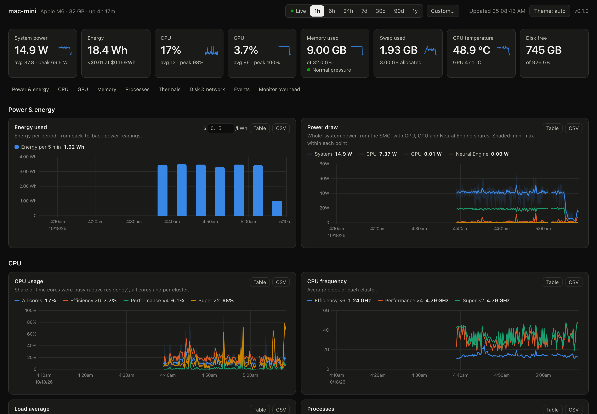

# mac-monitor

A tiny, always-on system monitor for Apple Silicon Macs. It records power, CPU, GPU, memory,
thermals, disk, network and per-process usage around the clock, keeps a year of history, and
serves a dashboard you open in any browser.

It is built for Macs that run long jobs (agents, model servers, builds) where you want to know
what used which resources and how much energy over hours, days and months, without paying for a
monitoring stack. One ~3 MB binary replaces macmon + Prometheus/VictoriaMetrics + Grafana:
no runtime, no database server, no sudo.



## Features

- **Power and energy.** System, CPU, GPU and Neural Engine power from back-to-back readings
  (every 2 s, every 1 s while you watch live), so energy totals cover every second instead of
  extrapolating from one scrape every 15 s. Energy per minute / hour / day / week, with cost at
  your electricity price.
- **Nothing lost between points.** Each stored point keeps the average, minimum and maximum of
  the samples it covers. A short spike still shows on a 30-day chart (as the shaded band).
- **Memory as macOS sees it.** App, wired, compressed, cached and free memory (Activity
  Monitor's breakdown), memory pressure over time, swap use and swap traffic.
- **Per-process groups.** CPU, memory footprint, GPU time, attributed CPU energy and disk I/O,
  summed per app (all `Brave Browser Helper` processes count as `Brave Browser`) or per process
  name. A sortable table shows CPU time, peak memory and energy for any range.
- **Events.** Boots, sleep periods, monitor restarts, memory and thermal pressure changes, and
  long-running processes that exited (with how long they ran and their peak memory), marked on
  the charts and listed in an event log.
- **Alerts.** Critical memory pressure, heavy swapping, high CPU temperature, thermal throttling
  and low disk space. Shown as events; optionally as macOS notifications or
  [ntfy](https://ntfy.sh) pushes.
- **Long history, small disk.** 15-second resolution for 14 days, 5-minute resolution for a
  year (both configurable), in one compressed SQLite file.
- **Live mode.** 1-second updates over Server-Sent Events while the live view is open.
- **Dashboard UX.** Time presets from 15 minutes to a year, custom ranges, drag to zoom, a
  crosshair synced across all charts, legends that read out values, table view and CSV export
  for every chart, light and dark themes.
- **Prometheus export.** `/metrics` for scraping by an existing Prometheus or VictoriaMetrics.

## Resource use

Measured on a Mac mini (M6, 12 cores, macOS 27) with no dashboard open, after 10 minutes,
next to the macmon + VictoriaMetrics pair it replaces:

| | mac-monitor | macmon `serve` | VictoriaMetrics |
|---|---|---|---|
| Memory footprint | 6.3 MB | 5.4 MB | 121 MB |
| CPU (% of one core) | 0.2–0.3% | 0.4% | 0.3% |
| Wakeups in 10 min | ~120 | ~2,100 | ~80,000 |
| Threads | 2 | 2 | 18 |

Disk use is estimated at ~3 MB per day for 15-second data (~40 MB kept over 14 days) and
~150 KB per day for 5-minute data (~55 MB per year): under 100 MB at steady state. The binary is
2.8 MB.

While no browser is connected the HTTP server does no work at all. The recurring cost is the
sampler, and most of it is macOS reading the temperature sensors: it runs every 2 s, and every
1 s only while a live view is open. `--sample-ms 5000` cuts it further at the price of coarser
min/max bands (energy totals stay exact at any interval).

## Requirements

- A Mac with Apple Silicon (M1 or later). Developed and tested on macOS 27 (M6); the hardware
  readings come from macmon, which supports M1 through M6
- No root: everything is read with the current user's permissions

## Install

### From a release

```sh
curl -fsSL https://raw.githubusercontent.com/sakshamgupta05/mac-monitor/main/install.sh | sh
```

The script downloads the latest release, checks its SHA-256, installs `mac-monitor` into
`~/.local/bin` and registers it to start at login. To do it by hand, download
`mac-monitor-<version>-aarch64-apple-darwin.tar.gz` from the releases page, then:

```sh
tar -xzf mac-monitor-*-aarch64-apple-darwin.tar.gz
cd mac-monitor-*-aarch64-apple-darwin
xattr -d com.apple.quarantine mac-monitor 2>/dev/null   # only if downloaded with a browser
install -m 755 mac-monitor ~/.local/bin/
~/.local/bin/mac-monitor install
```

### From source

Needs Rust (1.88+) and Node.js (20+).

```sh
git clone https://github.com/sakshamgupta05/mac-monitor && cd mac-monitor
make install            # builds the dashboard and binary, installs to ~/.local/bin, starts at login
```

Use `make install PREFIX=/usr/local` to install elsewhere.

### Open the dashboard

<http://127.0.0.1:9393/>

## Running as a service

`mac-monitor install` writes a LaunchAgent (`~/Library/LaunchAgents/io.github.mac-monitor.plist`)
that starts `mac-monitor serve` at login, restarts it if it exits, and runs it as a background
process (efficiency cores, throttled I/O). Options given to `install` are passed to `serve`:

```sh
mac-monitor install --notify --raw-retention-days 30
mac-monitor status      # LaunchAgent state and server health
mac-monitor uninstall   # stop and remove the LaunchAgent; recorded data is kept
```

Logs go to `~/Library/Logs/mac-monitor.log`. To run in the foreground instead, run
`mac-monitor` (same as `mac-monitor serve`).

> A LaunchAgent starts when you log in. On a headless Mac that should record from power-on,
> enable automatic login, or with FileVault on, reboot remotely with `sudo fdesetup authrestart`.
> Also consider `sudo pmset -a sleep 0` (sleep pauses recording; sleeps show up as gaps and
> events) and `sudo pmset -a autorestart 1` (power back on after an outage).

## Viewing from other devices

The server listens on `127.0.0.1:9393` only. To reach it from your other devices with
[Tailscale](https://tailscale.com), keep it on localhost and let Tailscale proxy it with HTTPS
on your tailnet:

```sh
tailscale serve --bg 9393
```

then open `https://<machine>.<tailnet>.ts.net/`. To listen on all interfaces instead, use
`--listen 0.0.0.0:9393`. There is no authentication, so only do that on a network you trust.

## Options

| Option | Default | |
|---|---|---|
| `--listen` | `127.0.0.1:9393` | Address of the dashboard and API (env `MAC_MONITOR_LISTEN`) |
| `--data-dir` | `~/Library/Application Support/mac-monitor` | Database location (env `MAC_MONITOR_DATA_DIR`) |
| `--sample-ms` | `2000` | Sampling interval, 250–15000 ms |
| `--live-sample-ms` | `1000` | Sampling interval while a live view is open |
| `--raw-retention-days` | `14` | How long 15-second data is kept |
| `--retention-days` | `365` | How long 5-minute data and events are kept |
| `--alert-cpu-temp` | `100` | Alert when CPU temperature stays above this (°C) for 2 minutes |
| `--alert-disk-free-gb` | `10` | Alert when free disk space drops below this |
| `--notify` | off | Show alerts as macOS notifications |
| `--ntfy-url` | none | Also POST alerts to an ntfy topic, e.g. `https://ntfy.sh/my-topic` |

The electricity price for the cost figures is set in the dashboard (stored in the browser).

## What is recorded

Every sample (stored as avg/min/max per 15 s):

| Series | |
|---|---|
| `power.sys`, `power.cpu`, `power.gpu`, `power.ane`, `power.ram`, `power.gpu_ram` | Watts |
| `cpu.active`, `cpu.scaled`, `cpu.tier.active:<tier>`, `cpu.tier.scaled:<tier>`, `cpu.tier.freq:<tier>` | CPU busy share (active residency), frequency-weighted share and clock, overall and per cluster (E/P/S) |
| `gpu.active`, `gpu.scaled`, `gpu.freq` | GPU busy share, frequency-weighted share, clock |
| `temp.cpu`, `temp.gpu`, `fan.rpm:<fan>`, `thermal.pressure` | Temperatures, fans, macOS thermal pressure level |
| `mem.used`, `mem.app`, `mem.wired`, `mem.compressed`, `mem.cached`, `mem.free`, `mem.total`, `mem.pressure` | Memory breakdown and pressure level |
| `swap.used`, `swap.total`, `swap.in`, `swap.out` | Swap use and traffic |
| `disk.read`, `disk.write`, `net.rx`, `net.tx`, `load.1` | Throughput (all block devices; `en*` interfaces) and load |

Every 15 seconds: `disk.free`, `disk.total`, `procs.count`, `self.cpu`, `self.mem`, and per
process group `proc.cpu`, `proc.mem`, `proc.gpu`, `proc.power`, `proc.disk_read`,
`proc.disk_write`, `proc.count` (`proc.<metric>:<group>`). A group gets its own series once it
uses ≥2% CPU, ≥128 MB, ≥0.1 W, ≥1% GPU or ≥4 MB/s disk, and keeps it for 10 minutes after;
smaller groups are summed into `other`.

## API

All times are unix seconds.

| Endpoint | |
|---|---|
| `GET /api/query?keys=a,b&match=proc.cpu:*&from=&to=&points=600` | Bucketed series: `ts` plus `avg` (and `min`/`max` for band series) per key. `step=86400&align=<tz offset>` for calendar buckets, `cov=1` for seconds covered per bucket (`avg × cov` integrates), `minmax=a,b` to limit min/max to some keys |
| `GET /api/summary?keys=&match=&from=&to=` | Per key: `avg`, `min`, `max`, `integral` (value-seconds; joules for watts), `cov`, `last` |
| `GET /api/events?from=&to=` | Event log |
| `GET /api/meta` | Machine info, settings, known series |
| `GET /api/live` | Server-Sent Events: `init` (the last 15 minutes of samples), then `row` every sample |
| `GET /api/health` | Liveness |
| `GET /metrics` | Latest values in Prometheus text format, e.g. `mac_monitor_power_sys_watts` |

To feed an existing VictoriaMetrics or Prometheus, add a scrape job for
`127.0.0.1:9393/metrics`.

## How it works

One process, two threads:

- **Collector.** Uses [macmon](https://github.com/vladkens/macmon) as a library for power,
  frequencies, residency and temperatures (IOReport, SMC, no sudo), plus `host_statistics64`,
  sysctl, IOKit and libproc for memory, pressure, disk, network and processes. Samples are folded
  into 15-second slots (avg/min/max) and 5-minute rollups. The last 15 minutes of samples stay
  in memory for live mode.
- **Storage.** SQLite (WAL) holding one compressed chunk per series per hour (15 s tier) or per
  day (5 min tier): byte-shuffled f32 arrays compressed with zstd. The chunk being written stays
  in memory and is flushed every minute, so a crash loses at most a minute. Old chunks are pruned
  hourly.
- **Server.** A single-threaded async HTTP server (axum on tokio's current-thread runtime) with
  the dashboard (TypeScript + [uPlot](https://github.com/leeoniya/uPlot), ~40 KB gzipped)
  embedded in the binary. Queries pick the coarsest tier that still gives one point per pixel.

## Limitations

- Only the current user's processes are visible per process (macOS needs root for others);
  the system totals cover everything.
- macOS attributes CPU energy to processes but not GPU energy; per-process GPU usage is
  reported as share of GPU time instead.
- Power counters come from undocumented interfaces via macmon. Some report 0 on some chips
  (e.g. DRAM power on M6 / macOS 27). Update to a newer release when macmon adds support for
  new chips.
- Network totals count `en*` interfaces only, so VPN tunnels aren't counted twice.

## Development

```sh
make web          # bundle the dashboard into web/dist (embedded by build.rs)
cargo run         # run from source on 127.0.0.1:9393
make test         # Rust unit tests + Playwright browser tests against a real server
make dist         # release tarball and checksum in dist/
```

While working on the dashboard, `npm --prefix web run watch` rebuilds `web/dist` on save;
rebuild the binary (`cargo build`) to embed the new assets.

`web/dist` is committed so that `cargo install --git` works without Node.js. Releases are
built by `.github/workflows/release.yml` when a `v*` tag is pushed.

## Credits

[macmon](https://github.com/vladkens/macmon) (MIT) for Apple Silicon metrics, and parts of the
per-process code adapted from it; [uPlot](https://github.com/leeoniya/uPlot) (MIT) for charts.
See [NOTICE](NOTICE).

## License

MIT
